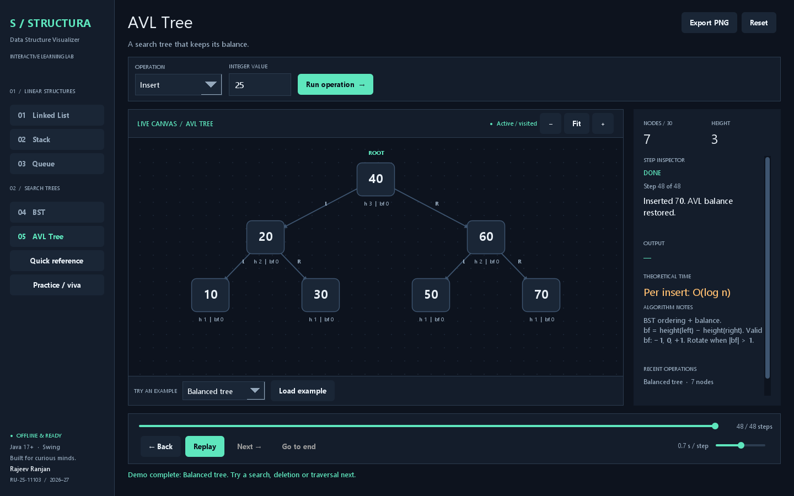

# Structura — Data Structure Visualizer

A Java Swing learning lab for **Linked List, Stack, Queue, Binary Search Tree and AVL Tree**. Built from the supplied Data Structure Visualizer interim report for the Object Oriented Programming with Java project.

**Student:** Rajeev Ranjan · RU-25-11103  
**Institution:** Rungta International Skills University  
**Session:** 2026–27



## शुरू कैसे करें

1. **`Run.cmd` पर double-click करें।** Java 17 या बाद का version चाहिए। इस development computer पर Java 21 मिला और उसी पर tests चले हैं।
2. Left sidebar से structure चुनें। `Integer value` भरें, operation चुनें और **Run operation** दबाएँ।
3. **Pause**, **Next**, **Back** और timeline से हर step समझें। नई operation के लिए playback पूरी करें या **Go to end** दबाएँ।
4. AVL में `LR rotation` example चुनकर **Load example** करें। यह presentation के लिए अच्छा शुरुआती demo है।
5. Class presentation और viva के लिए [हिंदी guide](docs/DEMO-HINDI.md) पढ़ें।

Direct command:

```text
java -jar dist/Structura.jar
```

No server, account, API key or internet connection is needed to run the application. The runtime JAR has no third-party dependencies. `Run.cmd` rebuilds only if the JAR is missing; after changing source, run `Build.cmd`.

## Features

| Structure | Implemented operations |
|---|---|
| Singly linked list | Insert/delete at zero-based index, first-match search, traversal, clear |
| Stack | Push, pop, peek, clear; top and LIFO labels |
| Queue | Enqueue, dequeue, peek, clear; front/rear and FIFO labels |
| BST | Insert, delete, search, inorder/preorder/postorder, clear |
| AVL | All BST operations; insert/delete balancing; LL, RR, LR, RL rotations |

- Explicit node-based implementations, separated from Swing views and playback.
- Immutable snapshots: node IDs, copied values and links, highlights, output and explanations.
- Play/pause, previous/next, replay, scrub timeline and adjustable delay.
- Actual intermediate rotation topology, node heights and balance factors.
- Context-sensitive input fields and validation before mutation.
- Unique node IDs distinguish duplicate values in linear structures; trees reject duplicate keys.
- 30-node limit, scrollable layouts, automatic fit and manual zoom.
- PNG export of the current canvas, guided examples, recent-operation list.
- Offline quick reference and six-question viva practice with explanations.
- Keyboard: **Ctrl+Space** play/pause; **Ctrl+Right** next; **Enter** in an input runs an operation.

Switching structures or choosing Reset starts an empty demonstration. A loaded example replaces the active structure. Rewinding changes only the displayed snapshot; the model is already at the operation's final state. New operations remain locked until the final frame. Reset and structure selection can cancel playback at any time.

## Build and test

Windows, with JDK 17+ on PATH:

```powershell
.\build.ps1          # compile and package
.\build.ps1 -Test    # build and run all dependency-free acceptance groups
```

Double-click alternatives: `Build.cmd` and `Test.cmd`. Close the running Structura window before rebuilding, because Windows locks a running JAR. The CMD launchers use a process-local PowerShell execution policy; they do not change the machine policy.

Linux/macOS build entry point, supplied but not executed on those platforms:

```sh
sh build.sh test
java -jar dist/Structura.jar
```

For an IDE, import `pom.xml` as a Maven project, select JDK 17+ and run `edu.rungta.dsv.Main`. Maven/JUnit workflow:

```text
mvn test
mvn package
java -jar target/data-structure-visualizer-1.0.0.jar
```

Maven downloads dependencies on first use. Maven itself was not installed on the development machine; the build scripts and the JUnit console runner were used for the recorded verification. `ModelJUnitTest` runs the same 12 groups under JUnit 5.

## Verification evidence

Recorded on **14 October 2026**, Windows, Java 21.0.10; compiled with `--release 17`:

- **12/12 acceptance groups passed.**
- **12/12 JUnit tests passed**, zero failures/errors/skips.
- 5,000 deterministic randomized BST/AVL attempts and 2,200 linear updates, checked against Java reference collections.
- Boundary validation, all four AVL rotations, deletion, stored heights, tree ordering, links, snapshot isolation and playback controls tested.
- Swing action and render checks at 1440×900 and 1280×720; 30-node linked list and skewed BST export rendering checked.

[Test record](docs/TEST-RESULTS.md) · [Raw acceptance output](docs/test-results.txt) · [JUnit output](docs/junit-results.txt)

Screenshots are generated by rendering the real Swing components in a headless test harness. They are not browser mockups. Automated UI tests exercise buttons, inputs and playback; native file chooser and interactive quiz dialogs still benefit from a manual rehearsal on the presentation laptop. No student usability study, learning-outcome claim or cross-platform certification is made.

## Project layout

```text
src/main/java/edu/rungta/dsv/
  Main.java                  Swing startup on the event dispatch thread
  model/                     Five models, nodes and immutable snapshot records
  controller/Controller.java Parsing, model selection and example construction
  animation/AnimationPlayer.java
  view/                      Workspace, canvas, theme and desktop frame
src/test/java/edu/rungta/dsv/
  Verification.java          Offline acceptance runner
  ModelJUnitTest.java        JUnit 5 adapter
dist/Structura.jar           Runnable Java 17-compatible desktop build
docs/                       Report, architecture, test record and Hindi demo guide
```

## Requirements and scope

Java **17+** is required; a JDK is required to rebuild. A 1280×720 display, keyboard/mouse, dual-core CPU and 4 GB RAM are practical targets from the interim report, **not measured minimum hardware specifications**. 8 GB RAM is helpful when an IDE is also running. The JAR is small; reserve about 1 GB for a JDK and development tools. Normal demonstrations work offline.

The first release uses 32-bit signed integers and one active structure. Graphs, heaps, sorting, databases, accounts, session persistence and side-by-side comparison are not implemented. It intentionally prioritizes the five structures promised in the report.

The displayed Big-O is the **theoretical core algorithm cost**. Copying each snapshot costs O(n); s snapshots require O(s×n) memory. Invariant checks and rendering add overhead. Animation delay and test-suite duration are not algorithm benchmarks. Clear drops references in O(1); eventual garbage collection is excluded.

[Implementation report](docs/PROJECT-REPORT.md) · [Architecture](docs/ARCHITECTURE.md) · [Requirements and next improvements](docs/REQUIREMENTS.md)
