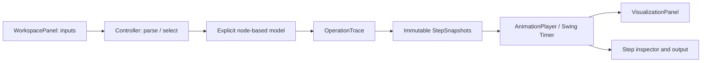

# Architecture and design decisions

## Application flow

The model completes one operation synchronously, capturing real intermediate states. The player then reads the recorded snapshots without changing the completed model. Previous-step/replay are visual time travel, not model undo. A partially viewed trace locks mutation controls, even while paused, preventing the displayed historical state from being mistaken for the current model.

## Packages

| Package | Responsibility |
|---|---|
| `model` | Node links, structural algorithms, validation, invariants, snapshots |
| `controller` | Structure selection, input parsing, complete guided examples |
| `animation` | Trace position, timer, pause/play/next/previous/seek/cancel |
| `view` | Swing controls, drawing, diagram export, lessons and practice |

`VisualizableModel` defines size, type, snapshot, execute and invariant-check methods. `AbstractModel` centralizes immutable trace construction. `LinearModel` supplies shared node-chain algorithms, while `LinkedListModel`, `StackModel` and `QueueModel` expose their respective operation sets. Each instance owns its own head/tail references. `BSTModel` supplies ordering and deletion; `AVLModel` adds balance checks and rotations. This preserves the report's separate concrete model classes while reducing duplicated pointer code.

## Node and snapshot semantics

- `ListNode`: stable ID, integer value, next reference.
- `TreeNode`: stable ID, key, left/right references, stored height.
- `NodeView`: immutable primitive drawing data; zero denotes a null edge.
- `StepSnapshot`: copied nodes, root/head ID, immutable highlight IDs, output, explanation and phase.
- `OperationTrace`: immutable list of snapshots, operation name, result and theoretical complexity.

Java records and `List.copyOf`/`Set.copyOf` prevent later mutations from altering recorded states. Linear duplicate values receive different IDs. Tree key replacement during two-child deletion retains the surviving node's identity and removes the successor's identity.

## Trees and AVL repairs

Insertion follows comparisons to a null child. Deletion handles leaf, one-child and two-child cases. Two-child deletion finds the inorder successor, copies its key and detaches it as one recorded topology change, so no snapshot shows duplicate keys or dangling links.

The repair path is collected from root to the affected position and processed bottom-up. Heights update from child heights. For AVL, a balance factor above +1 uses LL or LR repair; below -1 uses RR or RL repair. Child balance zero is handled by a single rotation during deletion. Parent references from the path let rotations reconnect their subtree immediately, so intermediate snapshots always remain attached to the root. Double rotations have separate after-first and after-second frames. Deletion can rebalance multiple ancestors.

Displayed snapshot heights are computed independently from that snapshot's topology in O(n). They remain meaningful during the interval before stored ancestor heights have been refreshed. Final invariant checks validate the actual stored heights.

## Drawing and threading

`VisualizationPanel.paintComponent` calls its superclass and draws with antialiased Graphics2D. Tree x coordinates use inorder rank; y coordinates use depth. Trees can therefore grow wide/tall without overlapping node rectangles. Scrollbars and zoom handle the 30-node maximum. Linear chains wrap every five nodes, with routed links between rows. Stack order is vertical and top-first. Labels explain highlighted nodes without relying on color alone.

`Main` uses `SwingUtilities.invokeLater`. `AnimationPlayer` uses `javax.swing.Timer`, never sleep on the UI thread. With the small demo limit, operations and trace creation remain synchronous on the event dispatch thread. If the limit is substantially raised, trace generation should move to a worker; do not simply increase the cap.

## Validation and invariants

The controller rejects invalid/overflowing integers. Models independently reject unsupported operations, invalid list indices, duplicate tree keys, empty pop/dequeue/peek and capacity overflow before mutation. Search misses are valid results, not errors.

After successful operations, chains check identity uniqueness, size and endpoints. Trees check strict ordering using long bounds, reachable node count, repeated identities and stored heights. AVL adds the balance bound. Independent tests compare results against ArrayList, ArrayDeque and TreeSet; they also verify snapshot links and metadata.

## Complexity boundary

| Core operation | Theoretical cost |
|---|---|
| List head insertion/deletion, tail append | O(1) |
| List indexed lookup/deletion, search | O(n) worst case |
| Stack push/pop/peek | O(1) |
| Queue enqueue/dequeue/peek | O(1) |
| BST insert/delete/search | O(h), O(n) worst case |
| AVL insert/delete/search | O(log n) |
| Full traversal | O(n) |

Trace snapshots cost O(n) each; a trace of s snapshots costs O(s×n) storage. Invariants cost O(n) after an operation. Drawing costs O(n) per frame. These educational overheads are deliberately excluded from the theoretical label. Snapshot lists do not replace the explicit node structure; standard Java collections are used only for traces, output, repair paths and tests.
