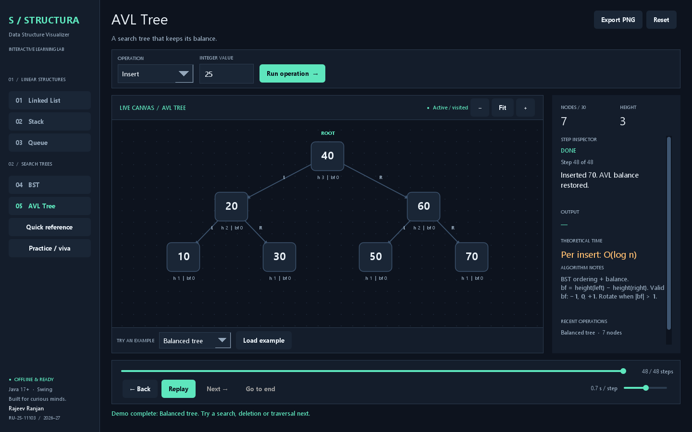
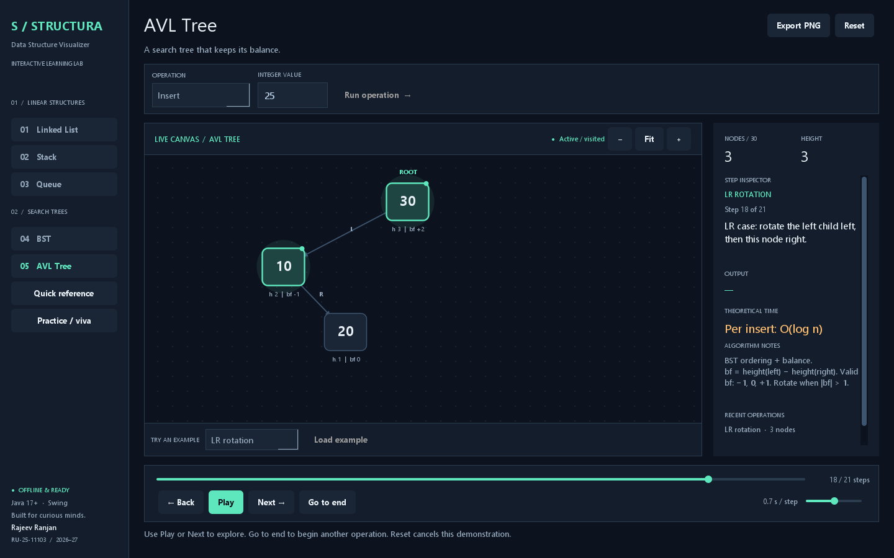

# Data Structure Visualizer — Implementation report

**Application:** Structura 1.0  
**Course:** Object Oriented Programming with Java  
**Student:** Rajeev Ranjan, RU-25-11103  
**University:** Rungta International Skills University  
**Session:** 2026–27  
**Implementation record date:** 14 October 2026

## Abstract

Structura is an offline Java Swing desktop application that demonstrates operations on a singly linked list, stack, queue, binary search tree and AVL tree. Users enter integer values, select operations and observe changes through immutable snapshots. A common workspace combines the structure diagram, step explanation, output, complexity label and playback controls. AVL demonstrations expose balance factors and all four rotation cases. The implementation separates models, controller, animation and view code, and has passed the included deterministic acceptance and JUnit test suites on Windows with Java 21.

## Problem and objectives

Static diagrams show a data structure's state but often hide the pointer changes and intermediate decisions that produced it. This project connects explicit Java implementations to observable states: traversal visits, changing access references, successor selection and tree rotations. Its scope follows the supplied 13-page interim report, which describes a proposed application rather than an already completed executable.

The completed objectives are five node-based models, zero-based linked-list operations, LIFO/FIFO demonstrations, BST traversals, AVL insertion/deletion balancing, input validation and controllable playback. The first release is restricted to integer data and 30 live nodes. Adding unrelated structures was not needed to meet the documented scope.

## Requirements traceability

| Interim report requirement | Implementation / verification |
|---|---|
| Java 17+, Swing, Graphics2D | `Main`, `VisualizerFrame`, `VisualizationPanel`; release-17 JAR |
| Five concrete node-based structures | LinkedListModel, StackModel, QueueModel, BSTModel, AVLModel |
| Insert/delete/search/traversal operations | Context-sensitive operation selector; model acceptance groups |
| Immutable animation snapshots | NodeView, StepSnapshot, OperationTrace; isolation test |
| Play, pause, next, adjustable delay | AnimationPlayer and Swing Timer; playback test |
| Reset cancellation and mutation lock | Workspace controls and UI integration test |
| AVL heights, balance and four rotations | AVLModel; rotation and deletion tests |
| Validation leaves model unchanged | Boundary tests and invalid-input UI action test |
| Thirty-node limit and scrolling | Model capacity checks; large-structure render tests |
| Model/controller/view separation | Distinct packages; architecture document |
| Tests and build artifacts | JUnit adapter, offline runner, runnable JAR, build scripts |
| User guide and project report | README, Hindi demo/viva guide, this report |

Additional completed features are previous-step replay, timeline seeking, guided examples, fit/zoom, PNG export, quick reference, recent-operation history and a short practice quiz. These are enhancements beyond the core interim scope.

## Implementation

Linear models own explicit linked nodes. Head/top/front operations use direct references; append/enqueue uses a tail/rear reference. Indexed linked-list operations locate a predecessor. Empty removal and invalid indices are rejected before mutation.

BST operations follow key comparisons. Deleting a node with two children uses the inorder successor. AVL applies the same ordering rules and repairs the affected path bottom-up, showing balance checks and individual rotations. Empty subtree height is zero; leaf height is one. Tree duplicates are rejected, while duplicate linear values have separate stable identities.

The model finishes an operation and returns copied visual states. Playback uses a Swing Timer on the event dispatch thread. The view never edits model nodes. Rewinding is visual replay; new operations stay disabled until the final state is shown. See [Architecture](ARCHITECTURE.md) for details and a flow diagram.

## User interface

The left sidebar chooses a structure. The operation bar shows only the relevant value/index fields. The central canvas labels root, head/tail, top or front/rear as appropriate. The right inspector explains the visible step, with output and theoretical cost. The lower transport area supports replay and manual stepping. Long trees and chains remain scrollable.

The LR example inserts 30, 10 and 20. It exposes the unbalanced root, then shows the left-child rotation and the root rotation separately. Its final root is 20 with children 10 and 30.

## Results and evaluation

The dependency-free acceptance runner passed all 12 groups. The same cases passed as 12 JUnit tests with no failures/errors/skips. Randomized verification included 5,000 BST/AVL attempts and 2,200 linear updates, compared with standard reference collections. Checks cover structure ordering, links, node identities, stored heights, AVL balance, rejected mutations and immutable snapshots. UI integration tests exercise real Swing buttons and render components at two display sizes.

These results establish tested functional behavior within the included cases. They do not constitute a formal proof of every possible input, a classroom usability evaluation or a performance benchmark. Recorded execution used Java 21 on Windows; compilation targets Java 17. See [Verification record](TEST-RESULTS.md) and the raw output files.

## Limitations and future work

The application does not persist sessions, implement graphs/heaps/sorting, synchronize across devices or compare two structures simultaneously. Native dialogs and projector interaction should be rehearsed manually. The model is bounded to 30 nodes, keeping trace recording and rendering practical. Big-O labels describe theoretical algorithms; snapshot copying, invariant checks and rendering add work and must not be used to claim measured O(log n) end-to-end UI latency.

Useful next work includes synchronized BST/AVL comparison, step-linked Java pseudocode, versioned session files and bilingual UI resources. Hardware targets and submission information still needed are listed in [Requirements](REQUIREMENTS.md).

## Source basis

The requirements were read from the user-supplied `Data Visualizer (Project).pdf`, 13 pages: scope (page 3), requirements (page 4), architecture (pages 5–8), algorithms (pages 9–10) and proposed tests (page 11). The source PDF remains unchanged. Its schedule and planned milestones were treated as background, not as evidence of completed work. This implementation report records only delivered features and checks actually run; it does not add a signed university certificate or approval.
